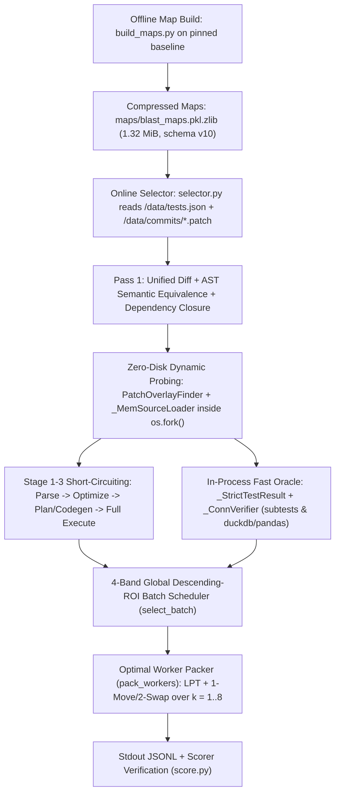
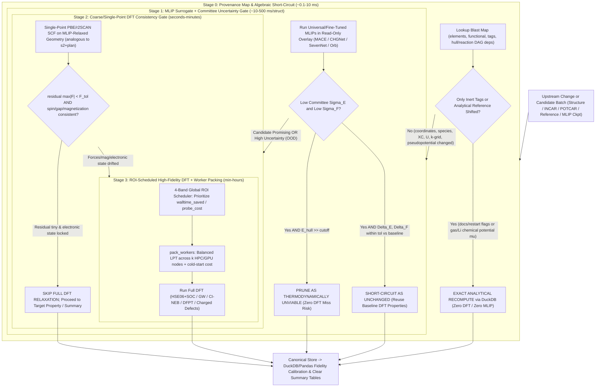

# Blast Radius: Selective Impact Engine, Staged Dynamic Probing & Scientific Workflow Extension Guide

**Blast Radius** is a high-precision, zero-miss **impact analysis, staged dynamic verification, and makespan-optimal worker scheduling engine** built for the RWX Blast Radius benchmark on [`sqlglot`](https://github.com/tobymao/sqlglot) (pinned at commit `eb11aec4be8cb2122afe713a4816662c3f0fb2fa`).

Instead of blindly re-running every downstream job whenever an upstream file, parameter, or routine changes, the engine combines:

1. **Precomputed static + dynamic provenance maps** ([`build_maps.py`](build_maps.py) -> `maps/blast_maps.pkl.zlib`),
2. **AST structural & semantic diff analysis** ([`selector.py`](selector.py)),
3. **Zero-disk in-memory overlay execution (`PatchOverlayFinder` + `os.fork()`)** for multi-stage deterministic short-circuiting,
4. **Global descending-ROI batch scheduling (`select_batch`)** under strict CPU/compute budgets, and
5. **Startup-aware 1..8 worker makespan packing (`pack_workers`)**.

While the code in [`selector.py`](selector.py) and [`build_maps.py`](build_maps.py) executes against `sqlglot` today, **the underlying architecture transfers directly to general data pipelines and high-throughput computational materials science workflows**—especially coupled **first-principles DFT** (`VASP`, `Quantum ESPRESSO`, `CP2K`, `GPAW`, `FHI-aims`) and **Machine Learning Interatomic Potential (MLIP)** (`MACE`, `NequIP`, `Allegro`, `CHGNet`, `M3GNet`, `Orb`, `SevenNet`, `EquiformerV2`) pipelines across **Catalysis**, **Solar / Photovoltaics**, **Battery Materials**, and **Semiconductors**.

---

## Table of Contents

- [1. Architecture Overview & Core Primitives](#1-architecture-overview--core-primitives)
- [2. Quickstart, CLI Reference, Scoring & Benchmarks](#2-quickstart-cli-reference-scoring--benchmarks)
  - [2.1 Running Locally & in Docker](#21-running-locally--in-docker)
  - [2.2 Input / Output Contract & Scoring Rules](#22-input--output-contract--scoring-rules)
  - [2.3 Container Sandbox Constraints & Guardrails](#23-container-sandbox-constraints--guardrails)
  - [2.4 Environment Variables & `build_maps.py` CLI](#24-environment-variables--build_mapspy-cli)
  - [2.5 Verified Performance (`v14-stage3-restore-and-turbo`)](#25-verified-performance-v14-stage3-restore-and-turbo)
- [3. Adapting Blast Radius to General Data & Scientific Problems](#3-adapting-blast-radius-to-general-data--scientific-problems)
- [4. Extending to Computational Materials Science: DFT + MLIP Workflows](#4-extending-to-computational-materials-science-dft--mlip-workflows)
  - [4.1 Why Blast Radius Fits High-Throughput Materials Discovery](#41-why-blast-radius-fits-high-throughput-materials-discovery)
  - [4.2 The 4-Stage Multi-Fidelity DFT + MLIP Short-Circuit Pipeline](#42-the-4-stage-multi-fidelity-dft--mlip-short-circuit-pipeline)
  - [4.3 Domain Blueprints](#43-domain-blueprints)
    - [Catalysis: Heterogeneous, Electrochemical, and Photocatalysis](#catalysis-heterogeneous-electrochemical-and-photocatalysis)
    - [Solar and Photovoltaics](#solar-and-photovoltaics)
    - [Battery Materials: Cathodes, Anodes, and Solid Electrolytes](#battery-materials-cathodes-anodes-and-solid-electrolytes)
    - [Semiconductors: Logic, Power Electronics, and Quantum Defects](#semiconductors-logic-power-electronics-and-quantum-defects)
- [5. Turning Raw DFT & MLIP Data into Clear Summary Results](#5-turning-raw-dft--mlip-data-into-clear-summary-results)
  - [5.1 Unified Simulation Record Schema](#51-unified-simulation-record-schema)
  - [5.2 Concrete Mapping to Existing Repository Components](#52-concrete-mapping-to-existing-repository-components)
  - [5.3 Multi-Fidelity Calibration & Summary Aggregation (DuckDB + Pandas)](#53-multi-fidelity-calibration--summary-aggregation-duckdb--pandas)
  - [5.4 Illustrative Multi-Domain Screening Summary Report](#54-illustrative-multi-domain-screening-summary-report)
- [6. Repository Layout, Testing & Troubleshooting](#6-repository-layout-testing--troubleshooting)

---

## 1. Architecture Overview & Core Primitives

The repository separates **offline baseline profiling** (performed once against the immutable baseline repo/dataset) from **online incremental selection** (executed at runtime inside a read-only container with no network and a strict CPU/walltime budget).



### Five General-Purpose Primitives in This Codebase

| Component in This Repo | Implemented Symbol(s) | What It Actually Does Here | Why It Generalizes to Any Data Pipeline |
| --- | --- | --- | --- |
| **1. Provenance & Sensitivity Maps** | [`build_maps.py`](build_maps.py) -> `maps/blast_maps.pkl.zlib` | Captures line-level test bitmasks (`line_cov`), dynamic file/directory/class/dict-key reads (`file_access`, `dir_access`, `class_usage`, `dict_key_usage`), transitive import graphs (`imports`, `rev_imports`), import-time/singleton lines (`once_lines`, `collection_lines`, `import_trigger_lines`), safe compare sites (`eq_safe_sites`), and stage-specific line masks (`tpcds_s2_lines`, `tpcds_s3_lines`, `tpcds_s3_query_cov`). | Replaces naive "rerun everything" DAG invalidation with exact line/parameter/input provenance closures stored as compact compressed bitmasks. |
| **2. Zero-Disk Copy-on-Write Overlay Sandbox** | [`PatchOverlayFinder`](selector.py#L92), [`_MemSourceLoader`](selector.py#L71), [`_install_fast_probe_sandbox`](selector.py#L323) | Applies patches in memory via Python `importlib.abc.MetaPathFinder`, forces lazy/safe C-extension handling, blocks `tempfile`/`subprocess` mutations, and executes probes inside ephemeral `os.fork()` children without touching disk. | Lets any pipeline evaluate speculative parameter changes or surrogate probes against large immutable read-only datasets without mutating canonical archives. |
| **3. Deterministic Multi-Stage Digest Short-Circuit** | [`_canon_cell`](selector.py#L42), [`_canon_digest`](selector.py#L60), `tpcds_parse_digests`, `tpcds_opt_digests`, `tpcds_digests` | Separates execution into deterministic stages (`Stage 1 parse` -> `Stage 2 optimize` -> `Stage 2 + Plan/Codegen` -> `Stage 3 execute`). If intermediate canonical digests match baseline, downstream stages are mathematically skipped with zero miss risk. | Transfers directly to multi-stage scientific/ETL workflows: cheap canonical fingerprints and surrogate models prune expensive full simulations/queries whenever intermediate states are invariant. |
| **4. 4-Band Global ROI Scheduler** | [`SelectorEngine.select_batch`](selector.py#L6584) | Scores candidate probes across the whole batch by `ROI = expected_simulated_ms_saved / estimated_probe_cpu_s`, running them in 4 prioritized ROI bands (`>= 5.0x` Tier-1, `>= 4.0x` Stage-3, `>= 1.55x` Tier-1, `>= 1.35x` Stage-3 + unmasked Tier-1) under a bounded CPU budget. | Optimally allocates limited compute/walltime across heterogeneous candidate checks before launching full cluster/HPC jobs. |
| **5. Startup-Aware Makespan Packer** | [`pack_workers`](selector.py#L6694) | Searches `k = 1..8` workers using Longest Processing Time (LPT) initialization + iterative 1-move and 2-swap local search to minimize `max(load_j) + WORKER_COST_MS * k` (`2,000 ms` fixed overhead per worker). | Directly models real distributed runner / SLURM queue / GPU container cold-start costs so fast jobs coalesce while heavy jobs parallelize cleanly. |

---

## 2. Quickstart, CLI Reference, Scoring & Benchmarks

### 2.1 Running Locally & in Docker

You need **Docker**, **Make**, and **Python 3.9+** (the container uses Python 3.13 via `Dockerfile`).

```sh
# 1. Build the docker image (linux/amd64 by default in Makefile)
make build

# 2. Build, run selector.py inside the sandbox limits on ./sample, and score against sample/answers.json
make sample

# 3. Validate JSONL output schema/rules only (drops scoring details)
make check
```

To run [`selector.py`](selector.py) directly in your local environment against the sample dataset and inspect the per-commit breakdown:

```sh
python3 tests_local/eval_sample.py
```

Or invoke [`selector.py`](selector.py) and [`score.py`](score.py) manually:

```sh
BLAST_DATA_DIR=./sample \
BLAST_SQLGLOT_DIR=./_sqlglot_baseline \
BLAST_MAPS_PATH=./maps/blast_maps.pkl.zlib \
  python3 selector.py > output.jsonl 2> trace.log

python3 score.py ./sample ./sample/answers.json output.jsonl
# Optionally include measured CPU seconds (user + sys):
python3 score.py ./sample ./sample/answers.json output.jsonl --cpu-seconds 3.443
```

### 2.2 Input / Output Contract & Scoring Rules

Full formal specification lives in [`SCORING.md`](SCORING.md) and [`score.py`](score.py).

| Interface | Format & Semantics |
| --- | --- |
| `/data/commits/<id>.patch` | Standalone unified diff against the pinned `sqlglot` baseline (`eb11aec4be8cb2122afe713a4816662c3f0fb2fa`). Commit ID is the filename without `.patch`. |
| `/data/tests.json` | `{"tests": [{"number": 12, "id": "tests/test_parser.py::TestParser::test_union", "file": "tests/test_parser.py", "seconds": 0.031}, ...], "skipped": [...]}` — dense 0-based `number`s. |
| `stdout` | One compact JSON line per commit: `{"commit": "k7q2", "workers": [[12, 845, 901], [3, 77]]}`. Use `"workers": []` when zero tests can fail. |
| `score.py --batch` | Harness batch scoring mode reading base64-encoded outputs from stdin. |

Every line on `stdout` is strictly checked (no NaN/Infinity, exact keys `{"commit", "workers"}`, valid commit IDs, no duplicates, `<= 8` non-empty workers, UTF-8 without BOM).

- **Commit simulated cost (integer milliseconds, `dur = floor(seconds * 1000 + 0.5)`):**
  - `0 ms` if `"workers": []`, else `max(sum(dur for t in w) for w in workers) + 2000 * len(occupied_workers)`.
- **Miss penalty:** `300,000 ms` (`300 s`) for every commit missing at least one failing test (`SUBFAILED` subtests under `pytest` 9 count as failures; unimportable test files and timeouts also count as failures).
- **Total run score:** `simulated_seconds + total_cpu_seconds` (`user + system` across all container processes). The server takes the median of 3 runs rounded to `0.1 s`. Build CPU is not charged.

### 2.3 Container Sandbox Constraints & Guardrails

Per the benchmark specification and [`Makefile`](Makefile):

- **Build container:** has network access, 4 cores, 8 GB RAM, 10 min walltime, may install public packages from PyPI/npm/Docker Hub/GitHub fixed tags (`requirements.lock` lists the exact labeling environment; [`Dockerfile`](Dockerfile) installs `duckdb==2.0.0`, `numpy==2.5.5`, `pandas==3.1.1`, `python-dateutil==4.0.0`, `pytz==2026.6`, `tzdata==2026.6`, `typing_extensions==4.16.0`, `mypy_extensions==1.2.0` plus `sqlglot` tarball).
- **Runtime container:** `--platform linux/amd64 --network none --cpus 2 --memory 4096m --memory-swap 4096m --pids-limit 256 --read-only --tmpfs /tmp:rw,size=64m,mode=1777 --user 65534:65534` (`nobody`, `HOME=/tmp`).
- **Repository & output limits:** repository <= 20 MB (commit `maps/blast_maps.pkl.zlib` as a regular file—no submodules/LFS), `stdout <= 2 MB`, all logs strictly on `stderr`, files readable by `nobody` (`chmod a+rX`).
- **Integrity rules:** no precomputed patch-to-answer lookup tables (only baseline commit maps are permitted); comment-only diffs are not guaranteed harmless; `SKIP_INTEGRATION=0` was active when ground-truth labels were collected.

### 2.4 Environment Variables & `build_maps.py` CLI

Runtime tuning knobs read by [`selector.py`](selector.py):

| Variable | Default | Purpose |
| --- | --- | --- |
| `BLAST_DATA_DIR` | `/data` | Directory holding `tests.json` and `commits/*.patch`. |
| `BLAST_SQLGLOT_DIR` | `/app/sqlglot_src` (or `./_sqlglot_baseline`) | Pinned baseline `sqlglot` source tree used as the base for in-memory overlays. |
| `BLAST_MAPS_PATH` | `./maps/blast_maps.pkl.zlib` | Path to compressed baseline provenance/digest map (`.zlib`, `.pkl`, `.gz`, `.json`). |
| `BLAST_TRACE` | unset (`"1"` enables) | Emits per-commit rule triggers, selected counts, and worker cost JSON telemetry to `stderr`. |
| `BLAST_DISABLE` / `BLAST_ENABLE` | `""` | Comma-separated rule/probe toggles to disable or re-enable specific selector rules at runtime. |
| `BLAST_PROBE_BUDGET_S` | Auto-scaled: `min(110.0, max(45.0, 1.5 * n_commits))` (`45.0` single-commit) | Total CPU second budget across all dynamic probes in `select_batch`. |
| `BLAST_FAST_BUDGET_S` | Derived from probe budget | Explicit CPU cap for fast in-process `unittest` oracle probing. |
| `BLAST_S3_BUDGET_S` | Derived from probe budget | Explicit CPU cap for Stage-3 TPC-DS executor probing. |
| `BLAST_MAX_S3_QIDS` | `57` | Maximum Stage-3 TPC-DS executed queries eligible per commit probe. |

Map generation CLI in [`build_maps.py`](build_maps.py):

```sh
# Full multi-pass map build (coverage + dynamic hooks + static AST graphs + probes)
python3 build_maps.py <sqlglot_repo_dir> maps/blast_maps.pkl.zlib --cache-dir /tmp/rwx_cache [--use-cache]

# Incremental / targeted augmentation modes
python3 build_maps.py --augment <sqlglot_repo_dir> maps/blast_maps.pkl.zlib [cache_dir]
python3 build_maps.py --tpcds-probe-only <sqlglot_repo_dir> maps/blast_maps.pkl.zlib
python3 build_maps.py --fast-probe-only <sqlglot_repo_dir> maps/blast_maps.pkl.zlib
python3 build_maps.py --eqsites-only ...
python3 build_maps.py --pass2-only <sqlglot_repo_dir> <test_ids_json> <pass2_out_pkl> [pytest_targets...]
```

### 2.5 Verified Performance (`v14-stage3-restore-and-turbo`)

Observed results on `main` (`bd18dc2`, merging `v14-stage3-restore-and-turbo`):

| Verification Suite / Benchmark | Result | Notes |
| --- | --- | --- |
| **Selector unit & regression tests** (`pytest selftests tests_local/test_selector.py`) | **42 passed, 0 failed** (`82.20 s`) | Covers AST semantic equivalence, import/once-line closure, probe soundness, and worker packing. |
| **Sample set (`30` commits, `tests_local/eval_sample.py`)** | **94.878 s** simulated + **3.443 s** CPU = **98.321 s** total; **0 / 30 misses** | `104` total tests selected; sample oracle lower bound is `94.351 s`. |
| **Zero-write read-only sandbox audit** (`AUDIT_WRITE_OPENS=[]`) | **0 write opens** in both venv (`94.878 s`, `0/30` misses) and bare `env -i /usr/bin/python3 -B` (`97.273 s`, `0/30` misses) | Verifies strict `--read-only` compliance under minimal interpreter environments. |
| **175-mutant synthetic stress suite** (`45 s` batch budget) | **1,261.735 s** sim + **44.478 s** CPU = **1,306.213 s** net; **0 / 175 misses** | `-183.602 s` net improvement vs `v12` (`5cecc81`). |
| **175-mutant synthetic stress suite** (`90 s` batch budget) | **1,135.371 s** sim + **88.250 s** CPU = **1,223.621 s** net; **0 / 175 misses** | `-198.530 s` net improvement vs `v12` (`5cecc81`). |

---

## 3. Adapting Blast Radius to General Data & Scientific Problems

Strip away `sqlglot`-specific syntax and Blast Radius is a **domain-agnostic incremental verification and compute-scheduling engine**. Any workflow where upstream code, configuration, schema, or parameter perturbations trigger expensive downstream evaluations shares the exact same optimization geometry:

| Blast Radius Primitive | General Data / ETL / ML / Analytics Equivalent | Computational Physics / Materials Equivalent |
| --- | --- | --- |
| `/data/commits/<id>.patch` | Git PR, SQL/dbt model edit, feature transform diff, hyperparameter config change | Updated crystal structure (POSCAR/CIF), `INCAR`/`KPOINTS`/`POTCAR` change, new MLIP weights, updated reference chemical potential $\mu_i^0$ |
| `/data/tests.json` (`number`, `seconds`) | Downstream analytics queries, Parquet partitions, ML validation suites + historical runtimes | Downstream property workflows (slab adsorption, NEB barrier, HSE06 bandgap, DFPT phonon, defect cell) + logged node-hours |
| `line_cov` / `file_access` / `dict_key_usage` | Column/table/key lineage DAG (e.g., DuckDB/SQLGlot column lineage, Pandas transform keys) | Structure/species/tag/pseudopotential provenance graph (which jobs read `HUBBARD_U["Ni"]`, `IVDW`, or surface `*OOH` reference) |
| **Stage 1 -> Stage 2 -> Stage 3 Digests** | Schema/AST equality -> dry-run query plan digest -> sample-partition checksum -> full backfill | Symmetry/provenance hash -> MLIP surrogate gate ($\sigma_E, \sigma_F$) -> single-point PBE SCF -> full HSE06 / GW / CI-NEB |
| `PatchOverlayFinder` + `os.fork()` | Ephemeral in-memory overlay on read-only lakehouse/Parquet snapshots | Speculative evaluation against immutable VASP/ASE/extxyz archives via copy-on-write workers without corrupting provenance stores |
| 4-Band Global ROI Scheduler (`select_batch`) | Under fixed CI/cloud budget, verify highest `compute_saved / probe_cost` checks first | Under fixed SLURM/GPU allocation, triage candidates yielding maximum DFT hours avoided per MLIP/SP-DFT core-minute |
| `pack_workers` (`+2.0 s` worker startup penalty) | Pack tasks across containers/Spark executors accounting for image pull / JVM / model load time | Pack jobs across HPC nodes / A100 GPUs accounting for SLURM queue latency, MPI startup, POTCAR/basis I/O, or MLIP graph compilation |
| `300 s` Miss Penalty | Strict SLA / zero-silent-corruption invariant (`0` unflagged broken downstream tables or biased metrics) | Strict scientific validity invariant (`0` false-stable hulls, unflagged magnetic flips, or missed kinetic barriers) |

### Four Engineering Rules When Porting to a New Domain

1. **Over-approximate provenance before pruning dynamically.** Start with a conservative static dependency map (`build_maps.py` pattern) so **false negatives (misses) = 0**; let runtime probes—never blind heuristics—win back compute savings.
2. **Design canonical, float-safe stage digests (`_canon_cell` / `_canon_digest`).** Normalize floating-point noise (tolerances, `-0.0` vs `+0.0`, NaN representations, sorted keys) so semantically identical intermediate states hash identically across stages.
3. **Budget dynamic probes globally across the batch by ROI, not FIFO order.** Running cheap high-ROI checks (`ROI >= 5x`) across all pending perturbations first prevents low-ROI tail work from starving obvious wins.
4. **Coalesce micro-jobs, parallelize only past the startup knee.** `pack_workers` automatically collapses tiny jobs onto fewer workers when `total_duration` is small relative to `WORKER_COST_MS`, avoiding catastrophic startup tax.

---

## 4. Extending to Computational Materials Science: DFT + MLIP Workflows

> [!NOTE]
> **Extension Architecture Notice:** Out of the box, [`selector.py`](selector.py) and [`build_maps.py`](build_maps.py) operate on `sqlglot` ASTs, diffs, and test bitmasks. The designs below show **how to extend and adapt these exact primitives**—together with [`Dockerfile`](Dockerfile)'s bundled **`duckdb==2.0.0`, `pandas==3.1.1`, and `numpy==2.5.5`** stack—for computational materials discovery workflows mixing **first-principles DFT** and **MLIPs**.

### 4.1 Why Blast Radius Fits High-Throughput Materials Discovery

Modern catalysis, PV, battery, and semiconductor platforms maintain $10^4$ to $10^6$ DFT/MLIP artifacts (relaxed structures, charge densities, convex hulls, reaction networks, defect supercells, band structures) across `VASP`, `Quantum ESPRESSO`, `CP2K`, `GPAW`, `FHI-aims`, and ASE/pymatgen databases alongside fast neural potentials (`MACE`, `NequIP`, `Allegro`, `CHGNet`, `M3GNet`, `Orb`, `SevenNet`, `EquiformerV2`).

Four daily failure modes hurt both throughput and scientific reliability:

1. **Blind Re-Computation Storms:** Tweaking a Hubbard `U` value on `Co`, changing dispersion (`D3` -> `D4`), revising an `ENCUT` convergence target, updating a gas-phase reference ($\text{H}_2\text{O}/\text{H}_2/\text{O}_2$), or fine-tuning an MLIP checkpoint either triggers an unaffordable full-campaign DFT rerun—or worse, gets patched ad hoc, silently leaving stale energies mixed into convex hulls (`E_hull`), volcano plots, or voltage curves (**a scientific "miss"**).
2. **Cost Spread Spanning 6 Orders of Magnitude:**
   - Metadata / provenance / gas-reference shift: **~0.1 ms** (pure algebra)
   - Universal MLIP single-point / relaxation (`MACE-MP-0`, `CHGNet`, `SevenNet`, `Orb`): **10 ms – 1 s** (GPU)
   - Coarse PBE / r2SCAN single-point DFT: **10 s – 5 min**
   - Full DFT geometry relaxation / CI-NEB / DFPT phonons / charged defects: **0.5 – 24 node-hours**
   - Hybrid `HSE06+SOC`, `GW`, `BSE` optics: **10 – 100+ node-hours**
3. **Non-Zero Runner Cold Starts (`WORKER_COST_MS`):** SLURM queue wait, MPI/Wannier90 initialization, plane-wave basis allocation, and JAX/PyTorch JIT compilation impose steep per-worker fixed overheads—making [`pack_workers`](selector.py#L6694) directly applicable.
4. **Silent MLIP Hallucinations / Out-of-Distribution Failures:** Replacing DFT unconditionally with an MLIP causes catastrophic misses when an MLIP fails on spin-state crossover, Jahn-Teller distortion, defect localization, or strained transition states. Just like `selector.py` only drops tests when deterministic or verified probes prove safety, **an MLIP must only short-circuit DFT when calibrated epistemic uncertainty and structural/electronic invariants agree.**

### 4.2 The 4-Stage Multi-Fidelity DFT + MLIP Short-Circuit Pipeline

Compare this directly to `sqlglot`'s `Stage 1 (parse) -> Stage 2 (optimize) -> Stage 2+Plan -> Stage 3 (execute)` cascade:



How each stage enforces **zero scientific misses**:

- **Stage 0 (Map Closure + Algebraic Short-Circuit):** Analogous to `_ast_eq` / `_sem_eq` + `dict_key_usage` in [`selector.py`](selector.py). Changes to non-physical tags (`LWAVE`, `LCHARG`, comment lines, parser formatting) short-circuit to `0` work; changes to reference chemical potentials ($\mu_{\text{H}_2}$, $\mu_{\text{O}_2}$, $\mu_{\text{Li}}$) or post-processing dielectric constants ($\varepsilon_0$ in finite-size defect corrections) trigger **pure DuckDB/NumPy recomputation** across thousands of entries in milliseconds.
- **Stage 1 (MLIP Ensemble + Physical Filter):** Analogous to `_probe_fast_tests` / Stage-1 parse digests. Run a primary MLIP plus a lightweight committee or cross-architecture check (`MACE-MP-0` vs `CHGNet` / `SevenNet`, yielding epistemic uncertainty $\sigma_E, \sigma_F$). Unambiguously high-hull structures ($E_{\text{hull}}^{\text{MLIP}} - 3\sigma_E > E_{\text{cut}}$) are pruned cleanly without spending a second of DFT.
- **Stage 2 (Single-Point DFT on MLIP Geometry):** Directly analogous to `v14`'s `s2+plan` short-circuit (`Plan` on cached optimized geometry before full `PythonExecutor`). Running **1 SCF step** on an MLIP-relaxed slab, cathode, or crystal catches `~95%` of DFT relaxation costs while strictly verifying forces ($\max_i \|\mathbf{F}_i\|$), magnetic moments, and band occupancy with full quantum-mechanical rigor.
- **Stage 3 (Selective Exact DFT + Active Learning Loop):** Remaining ambiguous, high-uncertainty ($\sigma_F > \sigma_{\text{cut}}$), or high-value frontier candidates run full DFT (`CI-NEB`, `HSE06`, `GW`, `DFPT`), **and automatically feed back as labeled active-learning frames** to tighten the Stage-1 MLIP!

---

### 4.3 Domain Blueprints

#### Catalysis: Heterogeneous, Electrochemical, and Photocatalysis

- **Typical Simulation Data:**
  - Clean metal/alloy/oxide/single-atom slabs (`(111)`, `(100)`, `(211)`, reconstructed surfaces), adsorbed intermediates (`*H`, `*O`, `*OH`, `*OOH`, `*CO`, `*CHO`, `*COH`, `*N2`, `*NHx`), CI-NEB transition-state images, solvation/implicit-electrolyte runs (`VASPsol`, `Environ`), vibrational frequency calculations for Zero-Point Energy ($\text{ZPE}$) and entropy ($T\Delta S$).
- **Common Blast-Radius Triggers:**
  1. Updating gas-phase references ($\text{H}_2\text{O}, \text{H}_2, \text{CO}, \text{CH}_4, \text{N}_2$) or computational hydrogen electrode (CHE) $\Delta G_{\text{corr}}$ tables -> **impacts every reaction pathway's $\Delta G$ and overpotential $\eta$, yet requires zero slab DFT reruns!**
  2. Changing dispersion (`IVDW = 11/12` vs none) or dipole corrections (`LDIPOL`, `IDIPOL`) -> impacts **slab + adsorbate energies**, while bulk lattice parameters stay fixed unless `ENCUT`/`ISIF` changed.
  3. Re-training a catalysis MLIP (`OC20`/`OC22`-tuned `MACE` or `EquiformerV2`) -> triggers fast Stage-1 adsorption configuration screening across binding sites (top, bridge, hollow) on thousands of alloys.
- **Stage 0 -> 1 -> 2 -> 3 Decision Logic:**
  - **Stage 0:** Recompute all $\Delta G_i = \Delta E_i + \Delta \text{ZPE}_i - T\Delta S_i + \Delta G_{\text{solv},i} + \Delta G_{\text{U},i}$ purely in DuckDB when gas/ZPE/solvation corrections change.
  - **Stage 1 (MLIP):** Enumerate symmetry-unique adsorption sites (`pymatgen`/`CatKit`/`FairChem`), relax with MLIP + committee uncertainty $\sigma_E$; discard chemically desorbed or high-energy sites (`> 0.35 eV` above lowest site beyond $3\sigma_E$).
  - **Stage 2 (SP-DFT):** Run single-point PBE/RPBE(+D3) on the MLIP minimum site + initial/final NEB endpoints; skip ionic relaxation if $\max \|\mathbf{F}\| < 0.03\ \text{eV/\AA}$.
  - **Stage 3 (Full DFT):** Execute DFT CI-NEB (`IBRION=3`, climbing image) + finite-difference Hessian vibrational modes only on top Sabatier volcano candidates near optimal scaling descriptors ($\Delta G_{*\text{OH}}$, $\Delta G_{*\text{CO}}$, $\Delta G_{*\text{H}}$).
- **Summary Output Metrics:** `reaction` (HER/OER/ORR/CO2RR/NRR), `facet`, `adsorption_site`, $\Delta G_{\text{ads}}$ vector, `limiting_potential_U_L_V`, `theoretical_overpotential_eta_V`, `rate_determining_step`, `E_a_NEB_eV`, `selectivity_margin_eV`, `verification_tier`.

#### Solar and Photovoltaics

- **Typical Simulation Data:**
  - Bulk absorber crystal structures (halide/chalcogenide perovskites, kesterites $\text{Cu}_2\text{ZnSnS}_4$, III-V/II-VI alloys, oxide absorbers), `PBE`/`r2SCAN` relaxations, `HSE06` / `HSE06+SOC` / `G0W0` electronic band structures, frequency-dependent complex dielectric tensors $\varepsilon_1(\omega), \varepsilon_2(\omega)$ -> absorption coefficient $\alpha(E)$, and Spectroscopic Limited Maximum Efficiency (**SLME**).
- **Common Blast-Radius Triggers:**
  1. Elemental substitution or octahedral tilting polymorph edits in $ABX_3$ perovskites (changing steric tolerance factor $t$, $\text{Pb}/\text{Sn}$ SOC strength).
  2. Updating AM1.5G spectrum binning, film thickness $L$, or radiative-efficiency model -> **Stage 0 pure SLME recomputation** from existing $\alpha(E)$ and $E_g^{\text{dir}}/E_g^{\text{ind}}$ tables!
  3. Changing `HFSCREEN` / exact-exchange mixing $\alpha_{\text{EXX}}$ or `LSORBIT` (SOC) -> affects heavy elements (`Pb`, `Bi`, `Sn`, `I`, `Sb`, `Te`) strongly, while light-element decomposition phases on the convex hull often remain adequately described at `r2SCAN`.
- **Stage 0 -> 1 -> 2 -> 3 Decision Logic:**
  - **Stage 0:** Cache $\varepsilon(\omega)$ and recompute $\alpha(E)$ / SLME at arbitrary thickness $L \in \{0.2, 0.5, 1.0, 2.0\ \mu\text{m}\}$ without re-running optics DFT.
  - **Stage 1 (MLIP):** Screen polymorph energetics, finite-$T$ octahedral tilting stability (`MACE`/`SevenNet` NPT MD), and decomposition phase stability ($E_{\text{hull}}^{\text{MLIP}} < 50\ \text{meV/atom}$).
  - **Stage 2 (GGA/meta-GGA DFT Gate):** Run fast `PBE`/`r2SCAN` SCF to check direct-vs-indirect gap character ($E_g^{\text{dir}} - E_g^{\text{ind}}$), band dispersion / effective mass bounds, and magnetic/metallic collapse. Reject metals or deeply indirect absorbers *before* spending $100\times$ more compute on `HSE06+SOC` or `GW`.
  - **Stage 3 (Hybrid/Many-Body DFT):** Pack surviving candidates into GPU/HPC workers for `HSE06(+SOC)` / `G0W0` quasiparticle bandgaps + RPA/IPA optical spectra -> SLME ranking + defect-tolerance check (bonding/antibonding VBM/CBM character).
- **Summary Output Metrics:** `space_group`, `E_hull_meV_atom`, `E_g_PBE_eV`, `E_g_HSE_SOC_eV`, `gap_type` (`direct` / `quasi-direct` / `indirect`), `delta_dir_ind_eV`, `m_e_eff`, `m_h_eff`, `SLME_500nm_pct`, `decomposition_products`, `verification_tier`.

#### Battery Materials: Cathodes, Anodes, and Solid Electrolytes

- **Typical Simulation Data:**
  - Layered/spinel/olivine/polyanion intercalation hosts ($\text{Li}_x M\text{O}_2$, $\text{Na}_x\dots$, $\text{Mg}_x\dots$) across multiple states of charge ($x \in [0, 1]$) and cation orderings, ternary/quaternary competing phases for grand-canonical convex hulls, solid-state electrolytes (sulfides, halides, garnets, NASICON), multi-temperature NVT/NPT MD trajectories for Li-ion diffusivity $D(T)$, and CI-NEB hop barriers.
- **Common Blast-Radius Triggers:**
  1. Updating **Hubbard `LDAUU` on one transition metal** (e.g., `Ni` $U = 6.2 \to 6.0\ \text{eV}$) or changing anion $GGA/GGA+U$ mixing compatibility corrections -> **only structures containing `Ni` and grand-canonical hulls touching `Ni`-bearing tie-lines are invalidated!** (`Fe`/`Mn`-only phases untouched—exact analog of `dict_key_usage` in `build_maps.py`!).
  2. Updating the metallic anode reference ($\mu_{\text{Li}}$ / $\mu_{\text{Na}}$ / $\mu_{\text{Mg}}$) -> **Stage 0 instant algebraic recomputation** of all average voltages $V = -(E_{\text{Li}_y H} - E_{\text{Li}_x H} - (y-x)\mu_{\text{Li}}) / ((y-x)e)$ and electrochemical stability windows (ESWs).
  3. Generating new partially delithiated supercell enumerations or doping schemes -> triggers MLIP ranking of hundreds of electrostatic/vacancy orderings before DFT.
- **Stage 0 -> 1 -> 2 -> 3 Decision Logic:**
  - **Stage 0:** Propagate elemental chemical potential updates or Materials Project compatibility energy shifts analytically in DuckDB.
  - **Stage 1 (MLIP):** Use `CHGNet`/`MACE`/`SevenNet` (note `CHGNet` natively predicts site magnetic moments for oxidation-state tracking) to relax top enumerated delithiated orderings, filter high-energy cation arrangements (`> 30 meV/atom` above lowest ordering beyond $\sigma_E$), run 500–1200 K MLIP-MD Arrhenius ionic conductivity ($\sigma_i$, $E_a^{\text{MD}}$), and perform rapid MLIP-NEB hop pre-screening.
  - **Stage 2 (SP-DFT+U):** Validate magnetic ordering, transition-metal oxidation state (`magmom` check), and voltage plateau energy at low/high states of charge ($x=0, x=1$) via single-point `r2SCAN` or `PBE+U`.
  - **Stage 3 (Full DFT):** Execute DFT CI-NEB on bottleneck percolation hops and full hull/redox relaxation where MLIP uncertainty or Jahn-Teller distortion exceeds thresholds.
- **Summary Output Metrics:** `working_ion` (`Li`/`Na`/`Mg`), `avg_voltage_V`, `voltage_step_min_max_V`, `gravimetric_cap_mAh_g`, `volumetric_exp_pct`, `E_hull_charged_meV_atom`, `ESW_anodic_cathodic_V`, `E_a_migration_eV`, `sigma_300K_mS_cm`, `ox_redox_flag`, `verification_tier`.

#### Semiconductors: Logic, Power Electronics, and Quantum Defects

- **Typical Simulation Data:**
  - Conventional & primitive bulk semiconductors ($\text{Si}$, $\text{GaN}$, $\text{SiC}$, $\beta\text{-Ga}_2\text{O}_3$, diamond, III-V, 2D TMDs), spin-orbit/hybrid band structures, carrier effective mass tensors ($m_e^*, m_h^*$) & deformation potentials, harmonic/anharmonic phonon dispersions (`Phonopy` / `DFPT`), surface/interface slab band offsets, and large supercells (`64–256+` atoms) for native/dopant charged point defects ($V_X, M_X, X_i$, $q \in \{-3,\dots,+3\}$) with electrostatic image-charge corrections (FNV / Kumagai).
- **Common Blast-Radius Triggers:**
  1. Updating dielectric tensor $\varepsilon_0$, host VBM reference alignment, or elemental chemical potential facet limits ($\mu_{\text{Ga}}$-rich vs $\mu_{\text{N}}$-rich growth conditions) -> **Stage 0 pure algebraic recomputation** of every defect formation energy $\Delta E_f(D^q; E_F, \mu)$ and thermodynamic charge-transition level $\epsilon(q/q')$!
  2. Screening novel binary/ternary nitrides, oxides, or 2D materials for ultra-wide-bandgap (UWBG) power devices (Baliga figure of merit $\propto \mu E_c^3$).
  3. Screening host + dopant defects for spin-qubit candidates (`NV`-center analogs).
- **Stage 0 -> 1 -> 2 -> 3 Decision Logic:**
  - **Stage 0:** Recompute FNV/Kumagai finite-size corrections, self-consistent Fermi-level pinning ($n_0, p_0, [D^q]$ balance vs growth/annealing $T$), and $\epsilon(q/q')$ curves purely in DuckDB/NumPy.
  - **Stage 1 (MLIP):** Perform **harmonic phonon dynamical stability screening** ($\text{MLIP}$ force-constant matrix via finite displacements in `Phonopy`) in seconds rather than hours of DFPT! Immediately prune dynamically unstable polymorphs ($\omega_{\min}^2 < -0.05\ \text{THz}^2$) and pre-relax 128–256-atom defect supercells to within `< 0.02 eV/Å`.
  - **Stage 2 (SP-DFT / PBE-band Check):** Run cheap `PBE` static calculation on the MLIP-relaxed defect supercell (checking defect localization vs delocalized shallow state) or bulk cell effective mass / deformation potential check.
  - **Stage 3 (Full HSE06 / DFPT):** Pack surviving bulk/defect cells onto GPU/HPC nodes for `HSE06` defect formation energies (fixing DFT bandgap underestimation for deep levels $\epsilon(q/q')$), hyperfine/ZFS tensors, or exact `DFPT` Born charges + dielectric tensor $\varepsilon_0, \varepsilon_\infty$.
- **Summary Output Metrics:** `E_g_HSE_eV`, `gap_type`, `phonon_stable` (`min_freq_THz`), `m_e_tensor`, `m_h_tensor`, `electron_hole_mobility_proxy`, `eps_static`, `dominant_killer_defect`, `p_n_dopability_window_eV`, `CTL_levels_eV`, `verification_tier`.

---

## 5. Turning Raw DFT & MLIP Data into Clear Summary Results

A major bottleneck in materials informatics is **not just running simulations, but turning tens of thousands of heterogeneous DFT outputs (`vasprun.xml`, `OUTCAR`, `pw.out`, ASE `.db` / `.extxyz`) and MLIP inference logs into clean, trustworthy, audit-ready summary tables**.

Because [`Dockerfile`](Dockerfile) already installs **`duckdb==2.0.0`**, **`pandas==3.1.1`**, and **`numpy==2.5.5`**, you can pair Blast Radius's selective job engine directly with an analytical DuckDB summarization layer.

### 5.1 Unified Simulation Record Schema

Normalize both first-principles DFT runs and MLIP evaluations into a single canonical JSONL or Parquet schema (partitioned by `domain` and `fidelity_tier`):

```json
{
  "run_id": "cat_pt111_co_bridge_v4",
  "material_id": "mp-126_Pt_111",
  "domain": "catalysis",
  "formula": "Pt36CO",
  "elements": ["Pt", "C", "O"],
  "n_atoms": 38,
  "fidelity_tier": "S1_MLIP",
  "stage_code": "S1-MLIP-ShortCircuit",
  "code_or_model": "MACE-MP-0b2+committee3",
  "functional_or_basis": "PBE-D3-trained",
  "provenance_hash": "9b4f21c8e7a031d2",
  "parent_baseline_hash": "4a18c0f39e112b77",
  "energy_eV": -234.8124,
  "energy_per_atom_eV": -6.179274,
  "max_force_eV_A": 0.0084,
  "mlip_sigma_E_meV_atom": 4.2,
  "mlip_sigma_F_eV_A": 0.021,
  "walltime_s": 0.14,
  "converged": true,
  "metrics": {
    "delta_G_CO_eV": -1.42,
    "E_hull_meV_atom": 0.0,
    "E_g_eV": null,
    "avg_voltage_V": null,
    "E_a_eV": 0.78
  }
}
```

> **Canonical Hashing Note:** Always normalize floating-point outputs (e.g., [`_canon_cell`](selector.py#L42) + [`_canon_digest`](selector.py#L60)) when generating `provenance_hash` so trivial whitespace or zero-sign differences (`-0.0` vs `0.0`) do not cause false cache invalidations.

### 5.2 Concrete Mapping to Existing Repository Components

| Target Adaptation Module | Reuse / Adapt From This Repo | Specific Domain Extension |
| --- | --- | --- |
| `build_materials_maps.py` | [`build_maps.py`](build_maps.py) | Build compressed provenance maps (`element_cov`, `tag_cov`, `potential_cov`, `hull_deps`, `baseline_digests`, `walltime_ms`, `mlip_calibration_stats`) from baseline DFT + MLIP stores. |
| `materials_selector.py` | [`SelectorEngine`](selector.py#L1739) (`select_batch`, `_canon_digest`) | Replace `parse_git_diff` with `diff_workflow_spec(old_spec, new_spec)`; run **Stage 0** algebraic checks, **Stage 1** MLIP committee inference inside read-only worker subprocesses, **Stage 2** single-point DFT gates, and schedule **Stage 3** exact DFT in 4 descending-ROI bands (`walltime_saved_ms / probe_cpu_ms`). |
| `pack_workers(...)` | [`pack_workers`](selector.py#L6694) | Reuse directly! Set `WORKER_COST_MS` to your cluster's SLURM/GPU/MPI cold-start cost (e.g., `15_000`–`60_000 ms`) and `MAX_WORKERS` to node/GPU concurrency to pack DFT and MLIP jobs with near-optimal makespan. |
| `replay_score.py` | [`score.py`](score.py) | Backtest your MLIP uncertainty gates ($\sigma_E, \sigma_F$) against historical completed DFT trajectories: verify **`0` scientific misses** (no wrongly pruned ground-state/stable/active materials) before deploying on a live campaign. |

### 5.3 Multi-Fidelity Calibration & Summary Aggregation (DuckDB + Pandas)

Because `duckdb`, `pandas`, and `numpy` are already in the environment ([`Dockerfile`](Dockerfile)), the same container can join raw DFT and MLIP simulation tables, **quantify MLIP-vs-DFT error bounds automatically**, flag outliers for DFT escalation, and output clean summary tables:

```python
import duckdb

def summarize_materials_campaign(runs_parquet: str, out_prefix: str) -> None:
    """Calibrate MLIP vs DFT fidelity and emit clear per-domain summary reports."""
    con = duckdb.connect(":memory:")

    # 1. Calibration audit: measure exact MLIP-vs-DFT discrepancy where paired runs exist
    calibration_df = con.execute(f"""
        WITH paired AS (
            SELECT
                m.domain,
                m.material_id,
                m.code_or_model,
                m.mlip_sigma_E_meV_atom,
                (m.energy_per_atom_eV - d.energy_per_atom_eV) * 1000.0 AS err_meV_atom,
                ABS(m.max_force_eV_A - d.max_force_eV_A) AS force_diff_eV_A
            FROM read_parquet('{runs_parquet}') m
            JOIN read_parquet('{runs_parquet}') d
              ON m.material_id = d.material_id
            WHERE m.fidelity_tier = 'S1_MLIP'
              AND d.fidelity_tier IN ('S2_DFT_SP', 'S3_DFT_FULL')
              AND d.converged
        )
        SELECT
            domain,
            code_or_model,
            COUNT(*) AS n_paired_dft,
            ROUND(AVG(ABS(err_meV_atom)), 2) AS mae_E_meV_atom,
            ROUND(SQRT(AVG(err_meV_atom * err_meV_atom)), 2) AS rmse_E_meV_atom,
            ROUND(QUANTILE_CONT(ABS(err_meV_atom), 0.95), 2) AS p95_E_meV_atom,
            ROUND(AVG(force_diff_eV_A), 4) AS mae_F_eV_A,
            SUM(CASE WHEN ABS(err_meV_atom) > 25.0 THEN 1 ELSE 0 END) AS n_outliers_gt25meV
        FROM paired
        GROUP BY domain, code_or_model
        ORDER BY domain, mae_E_meV_atom
    """).df()

    # 2. Best-verified state per material + automatic escalation decision
    summary_df = con.execute(f"""
        WITH ranked AS (
            SELECT
                *,
                ROW_NUMBER() OVER (
                    PARTITION BY material_id
                    ORDER BY
                        CASE fidelity_tier
                            WHEN 'S3_DFT_FULL' THEN 3
                            WHEN 'S2_DFT_SP'   THEN 2
                            WHEN 'S1_MLIP'     THEN 1
                            ELSE 0
                        END DESC,
                        walltime_s DESC
                ) AS rn
            FROM read_parquet('{runs_parquet}')
            WHERE converged
        )
        SELECT
            domain,
            material_id,
            formula,
            fidelity_tier AS highest_tier,
            stage_code,
            ROUND(energy_per_atom_eV, 4) AS e_atom_eV,
            ROUND(mlip_sigma_E_meV_atom, 1) AS sigma_E_meV_atom,
            metrics,
            CASE
                WHEN fidelity_tier = 'S1_MLIP' AND mlip_sigma_E_meV_atom > 15.0
                    THEN 'ESCALATE_S2_OR_S3_DFT'
                WHEN metrics.E_hull_meV_atom IS NOT NULL AND metrics.E_hull_meV_atom > 120.0
                     AND COALESCE(mlip_sigma_E_meV_atom, 0.0) < 10.0
                    THEN 'PRUNED_UNSTABLE'
                ELSE 'VERIFIED_SUMMARY'
            END AS status,
            ROUND(walltime_s, 2) AS walltime_s
        FROM ranked
        WHERE rn = 1
        ORDER BY domain, status, e_atom_eV
    """).df()

    calibration_df.to_csv(f"{out_prefix}_calibration.csv", index=False)
    con.register("summary_tbl", summary_df)
    con.execute(f"COPY summary_tbl TO '{out_prefix}_summary.parquet' (FORMAT PARQUET)")
    summary_df.to_csv(f"{out_prefix}_summary.csv", index=False)
    summary_df.to_json(f"{out_prefix}_summary.jsonl", orient="records", lines=True)
```

### 5.4 Illustrative Multi-Domain Screening Summary Report

*Illustrative schema output produced by the summarizer above across all four target domains—showing at a glance which results were analytically updated (`S0`), safely resolved by MLIPs (`S1`), confirmed by single-point DFT (`S2`), or promoted to full DFT (`S3`):*

| Domain | Candidate ID | Key Domain Descriptor(s) | Provenance Stage | Uncertainty / Error Check | Decision | Compute Time |
| --- | --- | --- | --- | --- | --- | --- |
| **Catalysis** | `Pt3Ni(111)-*OH` | $\Delta G_{*\text{OH}} = 0.88\ \text{eV}$, $\eta_{\text{ORR}} = 0.35\ \text{V}$ | `S0-Algebraic` (CHE ref shift) | Exact analytical delta | `VERIFIED_SUMMARY` | `0.002 s` (saved `4.2 h` DFT) |
| **Catalysis** | `CuPd(211)-CO2RR` | $\Delta G_{*\text{CO}} = -0.61\ \text{eV}$, $E_a = 0.54\ \text{eV}$ | `S3-DFT-CINEB` | Escalated from MLIP ($\sigma_F = 0.09\ \text{eV/\AA}$) | `VERIFIED_SUMMARY` | `3.8 h` DFT |
| **Solar / PV** | `Cs2AgBiBr6_var` | $E_{\text{hull}} = 14\ \text{meV/at}$, $E_g^{\text{HSE+SOC}} = 1.98\ \text{eV}$, $\text{SLME}_{500\text{nm}} = 18.4\%$ | `S3-HSE06+SOC+RPA` | Passed `S2-r2SCAN` gap gate | `VERIFIED_SUMMARY` | `6.1 h` DFT |
| **Solar / PV** | `CsPbI3-orth-X` | $E_{\text{hull}} = 188\ \text{meV/at}$ | `S1-MLIP` (`MACE-MP-0`) | $\sigma_E = 4.1\ \text{meV/at}$ ($> 10\sigma_E$ above $120\ \text{meV/at}$ cut) | `PRUNED_UNSTABLE` | `0.18 s` (saved `9.5 h` HSE06) |
| **Battery** | `LiNi0.8Mn0.1Co0.1O2` | $\bar{V} = 3.84\ \text{V}$, $E_a^{\text{NEB}} = 0.29\ \text{eV}$, $\Delta V/V = 2.1\%$ | `S2-PBE+U-SP` on `CHGNet` | $\max\|F\| = 0.011\ \text{eV/\AA}$, magmom ok | `VERIFIED_SUMMARY` | `48 s` SP-DFT (saved `2.4 h`) |
| **Battery** | `Li10GeP2S12-doped` | $\sigma_{300\text{K}} = 11.4\ \text{mS/cm}$, $\text{ESW} = 1.72\text{–}2.28\ \text{V}$ | `S1-MLIP-MD` + `S0-Hull` | $\sigma_E = 18.7\ \text{meV/at}$ (OOD dopant) | `ESCALATE_S2_OR_S3_DFT` | `22 s` MLIP-MD |
| **Semiconductor** | `GaN-V_Ga(-3/+2)` | $E_g^{\text{HSE}} = 3.44\ \text{eV}$, $\epsilon(-2/-3) = 1.82\ \text{eV}$, $\omega_{\min} > 0$ | `S0-FNV` ($\varepsilon_0$ update) | Analytical FNV image update | `VERIFIED_SUMMARY` | `0.01 s` (saved `14 h` HSE06) |
| **Semiconductor** | `AlScN-polytype-B` | $\omega_{\min}^2 = -1.42\ \text{THz}^2$ (dynamically unstable) | `S1-MLIP-Phonopy` | $\sigma_F = 0.014\ \text{eV/\AA}$ | `PRUNED_UNSTABLE` | `1.9 s` (saved `22 h` DFPT) |

---

## 6. Repository Layout, Testing & Troubleshooting

| Path | Role |
| --- | --- |
| [`selector.py`](selector.py) | Online impact selector (`SelectorEngine`), AST equivalence checkers, `PatchOverlayFinder`, forked dynamic probe suite, 4-band ROI batch scheduler, `pack_workers`, and JSONL CLI entrypoint. |
| [`build_maps.py`](build_maps.py) | Offline baseline map builder producing `maps/blast_maps.pkl.zlib` (coverage, dynamic hooks, import graphs, once/collection lines, safe eq sites, TPC-DS stage digests, fast-probe allowlist). |
| [`maps/blast_maps.pkl.zlib`](maps/blast_maps.pkl.zlib) | Precomputed schema-v10 compressed provenance map (`~1.32 MiB`) for pinned `sqlglot` commit `eb11aec4be8cb2122afe713a4816662c3f0fb2fa`. |
| [`score.py`](score.py) | Exact official scorer & rule validator (`score_run`, `evaluate_run`, `--batch`). |
| [`Dockerfile`](Dockerfile) | Minimal `python:3.13-slim` container build installing pinned runtime deps (`duckdb`, `numpy`, `pandas`, `python-dateutil`, `pytz`, `tzdata`, `typing_extensions`, `mypy_extensions`) and `sqlglot_src`. |
| [`Makefile`](Makefile) | Reproducible `build`, `sample`, and `check` targets enforcing exact Linux `amd64` container security and resource limits. |
| [`SCORING.md`](SCORING.md) | Formal specification of inputs, JSONL line validation codes, worker timing arithmetic, miss penalties, and tie-breaking. |
| [`requirements.lock`](requirements.lock) | Complete locked Python package inventory of the ground-truth labeling environment (`pytest==9.2.0`, `duckdb==2.0.0`, `pandas==3.1.1`, etc.). |
| [`selftests/test_selector_rules.py`](selftests/test_selector_rules.py) | Comprehensive regression tests (`pytest`) for static rules, AST checks, probes, and worker packing. |
| [`tests_local/`](tests_local/) | Local evaluation & profiling harnesses: [`eval_sample.py`](tests_local/eval_sample.py), [`test_selector.py`](tests_local/test_selector.py), [`oracle_report.py`](tests_local/oracle_report.py), [`probe_bench.py`](tests_local/probe_bench.py). |
| [`sample/`](sample/) | Local 30-commit sample dataset (`sample/commits/*.patch`, `sample/tests.json`, `sample/answers.json`). |

### Running the Full Test & Evaluation Suite

```sh
# Run all selector regression tests (42 tests)
pytest selftests tests_local/test_selector.py

# Evaluate on the 30 sample commits with per-commit table + CPU measurement
python3 tests_local/eval_sample.py

# Debug selector decisions per commit via stderr JSON trace
BLAST_TRACE=1 BLAST_DATA_DIR=./sample python3 selector.py > /tmp/out.jsonl 2> /tmp/trace.jsonl

# Full container reproduction under server sandbox limits
make sample
```

### Troubleshooting Common Pitfalls

- **Strict stdout discipline (`Rejected: not_json on line 1`):** `stdout` must contain *only* answer JSON lines (one per commit, UTF-8 without BOM). Route every warning, progress log, or summary table to `stderr` or files.
- **Read-only rootfs & `nobody` permissions:** Never open files for write outside `/tmp` (64 MB tmpfs). Ensure maps and source files added to the Docker image are world-readable (`chmod -R a+rX`).
- **`pytest` 9 subtests (`SUBFAILED`):** Even if `pytest` summarizes a parent test beside `SUBFAILED` lines, any failing subtest marks that test number as failing (`_StrictTestResult` in [`selector.py`](selector.py#L218) handles `addSubTest` strictly).
- **`SKIP_INTEGRATION=0`:** `sqlglot` skips integration/executor tests unless `SKIP_INTEGRATION=0` is set; ground-truth labels were generated with `SKIP_INTEGRATION=0`.
- **Apple Silicon (`arm64`) vs Scorer (`linux/amd64`):** Always build and benchmark containers with `--platform linux/amd64` (already configured in [`Makefile`](Makefile)) so timings and binary wheels match the evaluation environment.
- **Matching the ground-truth Python packages:** When generating new baseline maps locally, install from [`requirements.lock`](requirements.lock) rather than `pip install -e .[dev]` so dependency behavior matches the pinned baseline environment.
